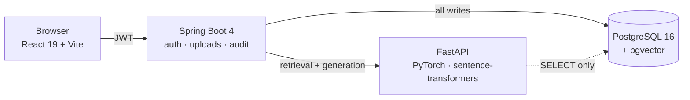

# AI Workplace Knowledge Assistant

Upload documents, ask questions in plain language, and get answers that cite the exact
sentence they came from. When the assistant decides an action should follow from an answer
— open a ticket, send a notice — it **proposes** that action and a human approves or
rejects it. It never acts on its own.

Four processes: a React SPA, a Spring Boot API, a Python GenAI service, and Postgres with
pgvector.



The browser never talks to the GenAI service. Spring owns every write; Python holds
`SELECT` on the chunk tables and nothing more. That boundary is specified in
[`INTEGRATION_CONTRACT.md`](backend/INTEGRATION_CONTRACT.md), not just observed.

## Stack

| | Stack | Port |
|---|---|---|
| **Frontend** | React 19, TypeScript, Vite, React Router, Vitest — plain CSS, no Tailwind | `5173` |
| **Backend** | Spring Boot 4, Java 21, Maven, Flyway (20 migrations), JJWT | `8080` |
| **GenAI** | Python 3.11, FastAPI, PyTorch, transformers, sentence-transformers | `8000` |
| **Database** | PostgreSQL 16 + pgvector — `vector(384)` embeddings | `5432` |

## The parts worth looking at

**Propose-never-perform.** The model never performs an action. It proposes one; a human
decides; every decision is audited, including rejections. Routing is derived from the
user's message alone, so text inside an uploaded document cannot forge an action — and a
migration (`V20__one_decision_per_action.sql`) makes each proposal decidable exactly once,
in the database rather than in application logic.

**Citations resolve to character offsets**, not to a document name. Every chunk's offsets
are verified against the extracted source text, so a citation points at the sentence that
produced the claim.

**Vector-space isolation.** `document_chunks` carries `embedding_model` and
`embedding_model_revision` alongside the vector. Re-embedding with a different model cannot
silently mix two incompatible vector spaces in one column, and models are pinned to a
revision rather than floating on `main`.

## Measured, not asserted

`backend/genai-service/benchmarks/` holds 28 scripts that produce the numbers quoted in the
project's notes, so a claim can be re-run instead of believed. Three that are
representative of how the work was done:

**Batching made embedding slower, and the first two explanations were wrong.** A sweep found
batch 1 fastest in both directions, ruling out thermal throttling. Core saturation was
tested and rejected; sequence length was tested and rejected. The cause turned out to be
padding from heterogeneous chunk lengths — uniform chunks make batching win, mixed chunks
make it lose badly. The two dead hypotheses are kept in the repo on purpose.

**Truncation is silent.** A 1,145-token text and its 510-token prefix embed to cosine
`1.000000`. Nothing in the API reports that the tail was discarded, which is why the chunk
ceiling is 510 rather than 512.

**The prompt-injection fence was asserted for ten days before it was tested.** Retrieved
chunks are user-uploaded content — the one place an attacker controls text reaching the
model. The test also showed what the grounding guard does *not* cover: an injected
instruction is retrieved text, so obeying it still produces high overlap. The guard defends
against invention, not against obedience.

A fourth is worth reading for its rejections: [`26_retrieval_gate.py`](backend/genai-service/benchmarks/26_retrieval_gate.py)
documents four candidate fixes for a retrieval failure, three of them measured and
discarded, which is why the fix that shipped is small.

## Layout

```
workspace-portal/
├── frontend/              React SPA
└── backend/               Spring Boot API
    └── genai-service/     FastAPI — retrieval, generation, citations
        └── benchmarks/    28 reproducible measurement scripts
```

## Running it

Full setup — prerequisites, database and pgvector, migrations, all four processes, first
user and admin grant — is in **[`backend/README.md`](backend/README.md)**, written as a
runbook and verified by a clean-room run. Its paths are relative to `backend/`, so start
there:

```bash
cd backend
```

Test suites run to roughly 212 (Spring), 457 (GenAI) and 37 (frontend), plus an opt-in
golden suite of 24 that scores retrieval, citation and answer separately — kept apart
because a single accuracy number repeatedly hid the case where retrieval was right and
generation was wrong.
