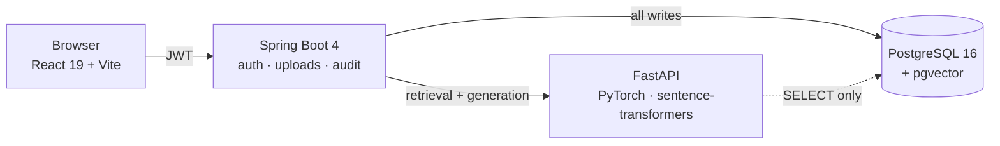

# AI Workplace Knowledge Assistant

Upload documents, ask questions in plain language, and get answers that cite the exact
sentence they came from. When an action should follow from an answer — create a task,
summarise a document — the assistant **proposes** it and a human approves or rejects it.
It never acts on its own.

Four processes: a React SPA, a Spring Boot API, a Python GenAI service, and PostgreSQL
with pgvector.



The browser never talks to the GenAI service. Spring owns every write; Python holds
`SELECT` on the chunk tables and nothing more. That boundary is specified in
[`INTEGRATION_CONTRACT.md`](backend/INTEGRATION_CONTRACT.md), not merely observed.

## Stack

| | Stack | Port |
|---|---|---|
| **Frontend** | React 19, TypeScript, Vite, React Router, Vitest — plain CSS, no Tailwind | `5173` |
| **Backend** | Spring Boot 4, Java 21, Maven, Flyway (25 migrations), JJWT | `8080` |
| **GenAI** | Python 3.11, FastAPI, PyTorch, transformers, sentence-transformers | `8000` |
| **Database** | PostgreSQL 16 + pgvector — `vector(384)` embeddings | `5432` |

Retrieval-augmented generation is built from primitives — extraction, chunking, embedding,
vector search — with **no LangChain or LlamaIndex**. Every rule in the pipeline is one this
corpus needed, and each has a measured reason recorded beside it.

```
workspace-portal/
├── frontend/              React SPA
└── backend/               Spring Boot API
    └── genai-service/     FastAPI — retrieval, generation, citations
        └── benchmarks/    30 reproducible measurement scripts
```

## The parts worth looking at

**Propose, never perform.** The model proposes an action; a human decides; every decision
is audited, including rejections. Routing is derived from the user's message alone, so text
inside an uploaded document cannot forge an action — and `V20__one_decision_per_action.sql`
makes each proposal decidable exactly once, in the database rather than in application
logic. That migration exists because the table had already collected five proposals decided
twice, one of them a rejection that ran anyway.

**Citations resolve to character offsets**, not to a document name. The model's quoted
sentence is matched back to the chunk that produced it, and an ambiguous match is dropped
rather than guessed — so a citation points at the sentence behind the claim.

**Semantic chunking.** Boundaries are placed where the meaning changes rather than where a
character count runs out, falling back to sentence-aware packing under the encoder's token
limit. Chunks never cross a page or heading, so the `page` and `section` on a citation stay
true. `document_chunks.chunking_strategy` records how each row was cut, so a corpus that
mixes strategies can say which is which.

**Vector-space isolation.** `document_chunks` carries `embedding_model` and
`embedding_model_revision` alongside the vector, and models are pinned to a revision rather
than floating on `main`. Re-embedding with a different model cannot silently mix two
incompatible vector spaces in one column.

**Answers can be refused.** A grounding check withholds an answer whose words do not trace
back to the retrieved passages, and a relevance floor produces `insufficient_context`
rather than an answer assembled from whatever scored highest. A system that always finds
something is worse than one that admits it cannot answer.

## Measured, not asserted

`backend/genai-service/benchmarks/` holds 30 scripts that produce the numbers the defaults
are set from, so a claim can be re-run instead of believed. Rejected hypotheses are kept on
purpose.

**Batching made embedding slower, and the first two explanations were wrong.** A sweep found
batch 1 fastest in both directions, ruling out thermal throttling. Core saturation was
tested and rejected; sequence length was tested and rejected. The cause was padding from
heterogeneous chunk lengths — uniform chunks make batching win, mixed chunks make it lose.

**Truncation is silent.** A 1,145-token text and its 510-token prefix embed to cosine
`1.000000`. Nothing in the API reports that the tail was discarded, which is why the chunk
ceiling is 510 rather than 512.

**The prompt-injection fence was asserted for ten days before it was tested.** Retrieved
chunks are user-uploaded content — the one place an attacker controls text reaching the
model. The test also showed what the grounding guard does *not* cover: an injected
instruction is retrieved text, so obeying it still produces high overlap. The guard defends
against invention, not against obedience.

**A bigger embedding model was tried and rejected.** `bge-base` inverts the ordering this
corpus turns on — an off-topic question outscores a genuine one — for double the storage
and triple the encode time. The measurement is in the repository so nobody repeats it.

A fourth is worth reading for its rejections:
[`26_retrieval_gate.py`](backend/genai-service/benchmarks/26_retrieval_gate.py) documents
four candidate fixes for a retrieval failure, three measured and discarded, which is why
the fix that shipped is small.

---

**Everything below is a runbook.** The test it is written against is: *another engineer can
start the application from these steps alone.* Start at §0 — it sets the working directory
every later path assumes.

---

## 0. The checkout

One repository holds all three services:

```bash
git clone https://github.com/rayyan2002/workspace-portal.git
```

```
workspace-portal/
├── frontend/              the SPA
└── backend/               the API, and genai-service/ inside it
    └── genai-service/
```

**Every relative path in this document is relative to `backend/`**, so `cd` there first and
commands like `cd genai-service` below work as written:

```bash
cd workspace-portal/backend
```

---

## 1. Prerequisites

| | Version used | Check |
|---|---|---|
| Java | 21 | `java -version` |
| PostgreSQL | 16 | `postgres --version` |
| Node.js | 24 | `node --version` (frontend only) |
| **Python** | **3.11 exactly** | `python3.11 --version` (GenAI service only) |
| Maven | **not required** | the repo ships `./mvnw` |

**Do not install Maven.** `./mvnw` downloads and uses its own (3.9.16). Every command below uses the wrapper; `mvn` is not on the PATH of the machine this was developed on and does not need to be on yours.

### Python 3.11 is not a preference

It is a constraint, measured on the machine this was built on (Intel Core i7-8750H, x86_64):

- **`python3` on PATH is 3.14 and has no torch wheel at all.** The install fails outright.
- **torch 2.2.2 is a hard ceiling** — PyTorch stopped publishing macOS x86_64 wheels after it.
- There is **no Apple Silicon here, so no MPS**; everything runs on CPU.

Every version in `genai-service/requirements.txt` is pinned to what torch 2.2.2 can work with. An unpinned `pip install` **exits 0 and leaves you with a broken environment**: numpy 2.x breaks torch's C API, and transformers 5.x disables PyTorch outright (*"PyTorch >= 2.5 is required but found 2.2.2"*). Read the comments in that file before changing a version.

### On Docker

There is no `docker-compose.yml`, deliberately. Docker is not installed on the machine this project was built on, so any compose file here would be **untested** — and a documented path that fails costs you more than an absent one, because you will trust it and debug it before doubting it.

If you prefer Docker for Postgres, you need only three facts: image `postgres:16`, a database named `knowledge_assistant_portfolio`, and point the app at it with `DB_URL`. See §3.

---

## 2. PostgreSQL

Installed here via Homebrew:

```bash
brew install postgresql@16
brew services start postgresql@16
```

Confirm it is accepting connections before going further — the backend will not start otherwise (§6):

```bash
pg_isready
# /tmp:5432 - accepting connections
```

Create the database:

```bash
createdb knowledge_assistant_portfolio
```

> **On the superuser.** A Homebrew install makes your macOS username the superuser, not `postgres` — so `psql -U postgres` fails here with `role "postgres" does not exist`. `createdb` with no `-U` uses your own account and is correct on any install. If you installed Postgres another way, use whatever superuser it created.

### pgvector — and why `brew install pgvector` is not the instruction

Month 3 stores embeddings in a `vector(384)` column, which needs the pgvector extension. On
this machine the obvious command produces nothing usable:

```bash
brew install pgvector    # DO NOT rely on this
```

It succeeds, and installs pgvector for **postgresql@17 and @18**. This project runs on
**16**, so the cluster still cannot see it — `CREATE EXTENSION vector` fails with
`extension "vector" is not available`, and `pg_available_extensions` shows nothing. Nothing
warns you that the install targeted a different major version.

Build it from source against the Postgres you actually run:

```bash
git clone --branch v0.8.0 https://github.com/pgvector/pgvector.git /tmp/pgvector
cd /tmp/pgvector
make PG_CONFIG=/usr/local/opt/postgresql@16/bin/pg_config
make install PG_CONFIG=/usr/local/opt/postgresql@16/bin/pg_config
```

`PG_CONFIG` is the whole point: it decides which Postgres the extension is compiled and
installed for. Without it the build targets whatever `pg_config` is first on `PATH`.

Then enable it **once per database**:

```bash
psql -d knowledge_assistant_portfolio -c "CREATE EXTENSION vector;"
```

> **Why this is not a Flyway migration.** `CREATE EXTENSION` needs superuser. A migration
> that demands one either fails for an ordinary application role or forces a privileged
> credential into the repository. `V18` therefore assumes the extension exists and fails
> loudly on a fresh database if it does not — which is the intended behaviour, not an
> oversight.

Verify before continuing:

```bash
psql -d knowledge_assistant_portfolio -c "SELECT extversion FROM pg_extension WHERE extname='vector';"
# 0.8.0
```

On macOS the built artifact is `vector.dylib`, not `vector.so`. That is normal.

### Do not pre-populate the database

Create it **empty** and let the application's migrations build it. This matters more than it sounds:

- **Empty database** → Flyway runs `V1`–`V25` and creates all 14 tables. Correct.
- **Database with any pre-existing table** → Flyway may baseline instead of migrating, skip the schema-creation migrations, and then fail on a later one with `relation "users" does not exist`.

That failure names what is *missing* rather than what was *skipped*, so the message points away from the cause. The setting that caused it has been removed from this project, but the general hazard is worth knowing: an empty database is the only starting state this runbook covers.

---

## 3. Configuration

Everything is environment-overridable with a working local default, so **no configuration is required to run in development**.

### The backend — environment variables

| Variable | Default | When you need it |
|---|---|---|
| `DB_URL` | `jdbc:postgresql://localhost:5432/knowledge_assistant_portfolio` | Non-default host, port, or database name |
| `DB_USERNAME` | your macOS username | Your Postgres user differs |
| `DB_PASSWORD` | *(empty)* | Your Postgres requires a password |
| `CORS_ALLOWED_ORIGINS` | `http://localhost:5173` | Frontend served elsewhere |
| `FRONTEND_BASE_URL` | `http://localhost:5173` | Where password-reset links point |
| `JWT_SECRET` | a checked-in **development** key | **Required** outside dev — see below |
| `JWT_ACCESS_TTL` / `JWT_REFRESH_TTL` | `15m` / `7d` | Shorten to test expiry behaviour |
| `MAIL_USERNAME` / `MAIL_PASSWORD` | *(unset)* | To actually send password-reset email |
| `UPLOADS_DIR` | `uploads` | Store document bytes elsewhere |

### The JWT signing key

The default is public — it is in this repository. Anyone holding it can mint a valid token for any user with any role. The application therefore **refuses to start** under any profile other than `dev`, `test`, or `local` while that default is in use:

```
Refusing to start: app.jwt.secret is still the development default, which is
committed to version control...
```

That is the guard working, not a bug. Generate your own:

```bash
export JWT_SECRET="$(openssl rand -base64 48)"
```

### Email

Off by default: password-reset messages are written to the application log instead of sent, so the whole flow is testable with no credentials anywhere. Sending switches itself on as soon as credentials exist — set `MAIL_USERNAME` and `MAIL_PASSWORD` and mail goes out. Gmail requires an **App Password**, not an account password.

Startup states which mode is active. Note that `POST /api/auth/forgot-password` returns `202` whether or not the send succeeded — deliberately, so the endpoint cannot be used to discover which addresses have accounts — so **the log is the only place a send failure appears**.

### The GenAI service — `genai-service/.env`, prefix `GENAI_`

Every value has a working default, so **the service runs with no configuration at all** — local models only, nothing leaves the machine.

| Variable | Default | When you need it |
|---|---|---|
| `GENAI_GEMINI_API_KEY` | *(unset)* | To use the cloud model. **Setting it means retrieved document text is sent to Google.** Absent, the service is local-only and asking for `gemini` returns a 503 naming the reason |

| `GENAI_GEMINI_MODEL` | a pinned model name | Google retires model names; a 404 from the cloud backend usually means this, not a bug |
| `GENAI_DEFAULT_GENERATION_BACKEND` | `local` | `gemini` to default to the cloud |
| `GENAI_DEFAULT_MIN_SCORE` | `0.60` | The similarity floor below which a chunk is not shown to the model |
| `GENAI_ANCHOR_MIN_SCORE` | `0.55` | The lower floor for chunks from the document the top hit already identified |
| `GENAI_DEFAULT_TOP_K` | `7` | How many chunks the model sees. **Spring sends this on every request, so it overrides this default** |
| `GENAI_LOAD_MODELS` | `true` | `false` skips the model load — used by the test suite |
| `GENAI_VERBOSE_TRACE` | `false` | Prints a full per-request report to stderr. A demo aid, **not** a log level — it writes document text, so it stays off during an incident |
| `GENAI_LOG_PROMPTS` | `false` | **Writes the full prompt, including the retrieved document text, to `logs/prompts.log` and into every `answers.jsonl` record.** This is the one setting that trades away the redaction guarantee below; the service logs a WARN at startup while it is on |

Configuration is validated **at startup**, not at first use. A bad value refuses to start and names the environment variable; it does not boot and quietly answer every question with nothing. `PRODUCTION_CHECKLIST.md` in the backend repository lists what each wrong value does, measured.

> **`.env` is gitignored and holds the API key.** There is no `.env.example`; the defaults
> above are the whole configuration, and the only thing you would put in `.env` is the key.
>
> **Changing `.env` needs a restart.** `uvicorn --reload` watches `.py` files only, so an
> edited `GENAI_*` value sits dormant while the old one keeps serving — a mistake made more
> than once here.

> **"Cloud" changes the generation model and nothing else.** The question is embedded by
> `bge-small-en-v1.5` **on this machine** and pgvector searches locally, on every request,
> whichever backend answers. Two things follow:
>
> - **Only the chunks that already cleared the relevance floor are sent to Google.** The
>   question is embedded locally and the corpus is searched locally, so documents that did
>   not match never leave the machine. That is most of why the privacy story holds.
> - **Switching to Cloud cannot rescue a retrieval failure.** If the embedder scores the
>   right passage below the floor, Gemini is handed the same wrong chunks — faster. A typo
>   or an unlucky phrasing is invisible to the backend choice (BACKLOG 26, 27).

### Models, and the first run

The first start downloads **~1.2 GB** of weights to `~/.cache/huggingface` and takes a few minutes. Both are pinned by revision, not just by name:

| | |
|---|---|
| Embedding | `BAAI/bge-small-en-v1.5` — 384 dimensions, matching the `vector(384)` column |
| Generation | `Qwen/Qwen2.5-0.5B-Instruct` — small enough for CPU, and it shows: expect 30–60s per answer |

Loading happens in a background thread, so the service answers `/health/ready` with `"loading"` and starts serving once both models are up. **A request before then returns 503, not a wrong answer.**

---

## 4. Run it

Four processes, in this order.

### 1 — PostgreSQL

```bash
brew services start postgresql@16
pg_isready
```

### 2 — GenAI service (port 8000)

First time only:

```bash
cd genai-service
python3.11 -m venv .venv
./.venv/bin/python -m pip install -r requirements.txt
```

Then, **from inside `genai-service`** — not from the repository root:

```bash
cd genai-service
./.venv/bin/python -m uvicorn app.main:app --host 127.0.0.1 --port 8000
```

The working directory matters. `app/config.py` sets `env_file=".env"`, which
pydantic-settings resolves against the process's working directory, *not* against
`--app-dir`. Started from the repository root it silently reads no `.env` at all: the
service comes up, the local models load, and the first Gemini request fails with
`Gemini was requested but no API key is configured`. Nothing warns you in between.

It binds `127.0.0.1` deliberately: **the service has no authentication and trusts the document ids it is handed**, so anything that can reach it can read any document. Do not expose it without putting something in front of it.

Ready when both models report in — the first start is slow because of the download:

```bash
curl http://localhost:8000/health/ready
# {"status":"ready","embedding_model":"BAAI/bge-small-en-v1.5",...}
```

While it is still loading that endpoint says so, and says which model it is waiting on.

### 3 — Backend (port 8080)

```bash
SPRING_PROFILES_ACTIVE=dev ./mvnw spring-boot:run
```

**The profile is not optional**, and this is the one step that will stop you if you skip it. Without it the application refuses to start, because the checked-in development signing key must not be what a forgotten environment variable grants you (§3). The message says exactly this and names the fix.

> **It refuses *after* printing the line you are waiting for.** Verified on a clean
> checkout: `Started KnowledgeAssistantApplication in 8.9 seconds` appears, and the process
> then exits 1 with `Refusing to start: app.jwt.secret is still the development default`.
> **The migrations have already run at that point** — the database is correctly built, so
> re-running with the profile set is all that is needed. Nothing is left half-applied.

First run applies all migrations : 25 of them, taking the database from empty to 14 tables. Ready when you see:

```
Started KnowledgeAssistantApplication in 8.9 seconds
```

and the process *stays up*.

Verify independently of the frontend:

```bash
curl http://localhost:8080/api/health
# {"status":"UP"}
```

### 4 — Frontend (port 5173)

In **`frontend/`** — the paths below are relative to `backend/`, as everywhere else in this document:

```bash
cd ../frontend
npm install
npm run dev
```

Open <http://localhost:5173>.

---

## 5. First run — there are no accounts

A freshly migrated database contains **zero users**. The seed migrations create demo accounts and a later migration retires them, because their password was published in this repository.

So the first thing to do is **sign up** at <http://localhost:5173/signup>. The account you create gets `ROLE_USER`.

### Becoming an administrator

Sign-up is public, so nothing self-service grants `ROLE_ADMIN`. There are two ways in, and
which one you need depends on whether an administrator already exists.

**If one does, use the app.** An administrator can promote anyone from
<http://localhost:5173/admin> — each user has a **Make admin** button, and an existing
administrator shows **Revoke admin** instead. Two refusals are enforced on the server: you
cannot remove your own access, and the last administrator cannot be demoted. Both guard the
same one-way door, since the endpoint that would undo the mistake is itself behind
`hasRole('ADMIN')`.

**If none does, there is a chicken and egg** — the promote endpoint lives inside the admin
guard. `V25__bootstrap_the_first_admin.sql` grants `ROLE_ADMIN` to one named account if it
exists, which is how this deployment got its first one. It grants a **role, never a
password**: the account must already have been registered through ordinary sign-up. On any
other clone it selects no rows and does nothing, so promote your own account directly:

```bash
psql -d knowledge_assistant_portfolio -c "
INSERT INTO user_roles (user_id, role_id)
SELECT u.id, r.id FROM users u, roles r
WHERE u.email = 'you@example.com' AND r.name = 'ROLE_ADMIN'
ON CONFLICT DO NOTHING;"
```

Sign out and back in afterwards — roles are baked into the access token when it is issued, so an existing token keeps its old roles until it expires (15 minutes) or you re-authenticate. That is inherent to stateless tokens, not a bug.

To check who has what:

```bash
psql -d knowledge_assistant_portfolio -c "
SELECT u.email, string_agg(r.name, ',') AS roles
FROM users u
LEFT JOIN user_roles ur ON ur.user_id = u.id
LEFT JOIN roles r ON r.id = ur.role_id
GROUP BY u.email ORDER BY u.email;"
```

Everything is scoped per user, so a new account correctly starts with an empty workspace — no documents, no conversations, no tasks. That is not a broken install.

---

## 6. Startup order, and why it is not arbitrary

**Postgres → GenAI → backend → frontend.**

- **Postgres before everything.** Both the backend and the GenAI service read it. The backend's connection pool fails fast at startup, so it exits rather than starting in a degraded state — the symptom is `Connection to localhost:5432 refused` inside a Flyway/Hikari stack trace.
- **GenAI before the backend, in practice rather than in principle.** The backend starts perfectly well without it and only calls it per request. But **uploading a document runs extraction, chunking and embedding synchronously through it**, so with the GenAI service down an upload fails and the document is left marked `failed`. Chat fails too. Starting it first is simply how you avoid both.
- **Backend before the frontend.** Vite serves fine without it, but every request past the login screen fails.
- **Restarting the backend no longer signs you out.** Refresh tokens live in Postgres and the signing key is stable across restarts, so a session survives a restart. This was not true earlier in the project, when tokens were held in memory.
- **The GenAI service can be restarted freely.** It holds no session state; the cost is the model reload, not a signed-out user.

---

## 7. The `prod` profile

Runnable locally. It is not a deployment target — it exists so the production-shaped configuration can be *checked* on a laptop, rather than written against an environment nobody has and found to be wrong on the first deploy.

```bash
JWT_SECRET="$(openssl rand -base64 48)" ./mvnw spring-boot:run -Dspring-boot.run.profiles=prod
```

Differences from dev:

| | dev | prod |
|---|---|---|
| Log format | readable console pattern | **one JSON object per line** (ECS) |
| SQL echo | on | off |
| Swagger UI | on | **off** (404) |
| Weak `JWT_SECRET` | warns | **refuses to start** |

`traceId` and `userId` are emitted as top-level JSON fields, not buried in the message, which is the point of the format:

```json
{"@timestamp":"...","message":"http method=GET path=/api/documents status=200 durationMs=73",
 "traceId":"6d25548e-...","userId":"05707c1c-..."}
```

---

## 8. Tests

Three suites, one per service. None of them needs the others running.

### Backend — 197 tests

```bash
./mvnw test
```

They create their own users and data and roll back, so they neither depend on nor pollute your database.

**When you change a migration, verify against a fresh database**, not your existing one. An incremental run cannot see a whole class of defect — this is how two real bugs were found:

```bash
createdb ka_verify
DB_URL=jdbc:postgresql://localhost:5432/ka_verify ./mvnw test
dropdb ka_verify
```

### GenAI service — 424 tests

```bash
cd genai-service
./.venv/bin/python -m pytest
```

No model is loaded and no database is touched: the encoder is faked and the DB connection is replaced, so the suite runs in seconds. That is the point — a test suite that needs 1.2 GB of weights is one nobody runs.

**Linting and type checking are separate gates and neither is implied by the tests:**

```bash
./.venv/bin/python -m ruff check app tests benchmarks
npx pyright app tests
```

Both are worth running. A pass of `pytest` and `ruff` together once hid 84 type errors, because neither of them type-checks anything.

### The golden set — 24 tests, deselected by default

```bash
cd genai-service
PYTHONPATH=$PWD ./.venv/bin/python -m pytest -m golden
```

Known questions with known sources, asserted against the **local** backend so it is deterministic and costs nothing. It loads both models and queries your real corpus, so it takes minutes and only works where documents exist — hence `addopts = -m 'not golden'`.

It is the regression test that matters for answer quality. It asserts retrieval reaches the right **chunk**, not merely the right document: a document-level assertion passed for the entire life of a bug where the right file was returned and none of the right text.

### Frontend — 22 tests

```bash
cd ../frontend
npm test            # vitest run
npm run lint
npm run build       # tsc -b && vite build — the type check is part of the build
```

---

## 9. Diagnosing a failure

Every response carries an `X-Trace-Id` header, and every log line carries the same id. To investigate any failure, take the id from the response and grep for it — that yields the request line, the service-level logs, and the stack trace together.

```
2026-09-01T12:47:42  WARN [8c1bb5e7-...] [9e3bc8dd-...] DocumentService : document.upload_rejected reason=unsupported_type
2026-09-01T12:47:42 ERROR [8c1bb5e7-...] [9e3bc8dd-...] RequestLoggingFilter : http method=POST path=/api/documents/upload status=500
```

The second bracket is the authenticated user, or `anonymous`.

**No request or response bodies are logged**, so no password, token, or document content reaches the log. `LogRedactionTest` fails if that regresses.

**The same trace id crosses into the GenAI service.** Spring forwards it as `X-Trace-Id`, so one `grep` follows a single question from the browser through retrieval and generation. (It did not for the first two months of the project: the GenAI service logged *"no X-Trace-Id header — caller should propagate it"* on every request, correctly, in a log nobody read for that purpose.)

### Why was this answer bad?

The GenAI service writes two files under `genai-service/logs/`, both rotating at 10 MB:

| | |
|---|---|
| `app.log` | the ordinary application log |
| `answers.jsonl` | **one JSON object per answer** — scores, counts, timings, token counts, model identity, which code path ran |
| `prompts.log` | the full prompt per request, **only when `GENAI_LOG_PROMPTS=true`** (§3) |

`answers.jsonl` carries **no document text, no question, no answer, and no quote**. The question appears only as a length and a hash, chunks only as UUIDs. It is safe to keep and to ship, which is the entire reason it can exist at all.

> **One setting changes that, and only one.** With `GENAI_LOG_PROMPTS=true` the full
> prompt — retrieved chunks included — is written to a third file, `logs/prompts.log`, and
> added to each `answers.jsonl` record as a `prompt` object. Both files then hold document
> text, and the paragraph above stops being true of this installation.
>
> It is off by default, the service logs a WARN at startup while it is on, and
> `tests/test_log_redaction.py` asserts **both** states — that nothing leaks with it off,
> and that with it on the prompt appears only in those two places. Turn it on to debug a
> prompt; do not leave it on where the logs are shipped.

Every record names a **verdict** and, when something is off, the **stage responsible** — because a bad answer looks identical from the outside whatever caused it:

| `verdict` | `suspect` | What it means |
|---|---|---|
| `grounded` | `none` | The answer's words came from the retrieved chunks |
| `no_evidence` | `retrieval` | Nothing cleared the score floor — the model was given no documents at all |
| `declined` | `generation` | Chunks were supplied and the model returned nothing |
| `ungrounded` | `generation` | The answer was **withheld**: too few of its words appear in the chunks |
| `unverified` | varies | Answered, but nothing could be traced to a source. `suspect` says whether the quotes failed to match (`generation`), the reply was malformed (`parsing`), or the passages were weak (`retrieval`) |
| `weak_evidence` | `retrieval` | Answered and cited, but the best chunk barely cleared the floor |

> **`grounded` means the words came from your documents. It does not mean the answer is
> correct.** This measures provenance, not truth — a model that reads the right passage and
> states the opposite of it scores perfectly here, and the small local model has done
> exactly that. Read `unverified` as *"nobody has checked this"*, never as *"this is a lie"*.

Useful queries:

```bash
cd genai-service
# every answer nobody could trace to a source, newest last.
# The first grep matters: records written before this field existed have no verdict at
# all, and inverting the match alone would return all of them.
grep '"verdict"' logs/answers.jsonl | grep -v '"verdict":"grounded"' | tail

# which stage is to blame, across the whole log
grep -o '"suspect":"[a-z]*"' logs/answers.jsonl | sort | uniq -c

# one request end to end, across both services
grep <trace-id> logs/app.log
```

### Common failures

| Symptom | Cause |
|---|---|
| `Connection to localhost:5432 refused` | Postgres not running → `brew services start postgresql@16` |
| `lock file "postmaster.pid" already exists` | Unclean Postgres shutdown; the PID it names is usually dead and recycled. Verify with `ps -p <pid>`, then remove the file and restart |
| `Port 8080 was already in use` | `lsof -ti :8080 \| xargs kill` |
| `Refusing to start: app.jwt.secret...` | Set `JWT_SECRET` (§3) |
| `relation "users" does not exist` | The database was not empty when first migrated (§2) |
| Reset email never arrives | Mail is off by default; the link is in the log (§3) |
| CORS error in the browser | Frontend not on `:5173` → set `CORS_ALLOWED_ORIGINS` |
| Upload stays `processing`, or fails | The GenAI service is down. Uploading runs ingestion through it synchronously (§6) |
| *"The AI service is still loading its models"* | Expected for the first minute or two, longer on the very first run while ~1.2 GB downloads. `curl localhost:8000/health/ready` says which model it is waiting on |
| Cloud answers fail with 404 | The Gemini model name was retired. Set `GENAI_GEMINI_MODEL` — and **restart**, because `--reload` does not watch `.env` (§3) |
| Cloud answers fail with 429 | The free tier's quota is **per day, per model**. Waiting will not help; switch to on-device or configure a different model |
| An answer with no citations | Normal when the model paraphrases rather than quoting. Check `verdict` and `suspect` in `answers.jsonl` before assuming it invented anything (§9) |
| `extension "vector" is not available` | pgvector was built for the wrong Postgres major version (§2) |

---

## 10. Layout

```
src/main/java/com/knowledgeassistant/
├── auth/          login, registration, refresh tokens, password reset
├── security/      Spring Security config, JWT filter, 401/403 handlers
├── user/          User, Role
├── chat/          sessions, messages, action proposals
├── citation/      links an assistant reply to its source document
├── document/      upload, download, ownership
├── task/          tasks created by approved actions
├── action/        the governance flow and its audit trail
├── admin/         ROLE_ADMIN endpoints
├── mail/          outbound email
├── common/        error envelope, domain exceptions, paging
└── config/        tracing, request logging, OpenAPI

src/main/resources/db/migration/   V1–V25, forward-only
```

```
genai-service/
├── app/
│   ├── routers/        /answer, /retrieve, /ingest, /health, /tools
│   ├── ingestion/      extract (pdf, docx, xlsx, csv, md), chunk, embed
│   ├── prompts/        versioned templates, and the parser that turns a reply into citations
│   ├── retrieval.py    pgvector search, duplicate collapsing, the score floor
│   ├── answering.py    prompt -> model -> answer + citations + the grounding guard
│   ├── generation.py   the local model and the Gemini client
│   ├── intent.py       which tool, if any, a message is asking for
│   ├── safety.py       quarantines instruction-like text found inside documents
│   ├── observability.py  the JSON answer trace, and the verdict in §9
│   └── config.py       every setting, validated at startup
├── evaluation/         the golden set and the router's training data
├── benchmarks/         the measurements the defaults are set from — read these before
│                       changing a threshold
└── tests/
```

```
frontend/src/
├── pages/          one per route: Chat, Documents, Actions, Admin, auth screens
├── components/     citation cards, action cards, message view, shared inputs
├── api/            the HTTP client, token storage, 401-refresh handling
├── context/        auth state
├── hooks/          data fetching
├── mocks/          MSW handlers — the tests run against these, not a live backend
└── Type.ts         hand-written mirror of the backend's DTOs
```

> **`Type.ts` is a hand-maintained copy of the backend's response shapes**, and nothing
> generates it. `Type.conformance.test.ts` exists to limit the drift; a rename on the Spring
> side that it does not catch is a runtime `undefined` in the browser, not a build error.

**Never edit an applied migration.** Flyway checksums them; editing one that has already run stops the application from starting. Add a new migration instead. (This was learned the hard way on Day 19 by editing a *comment*.)

---

## 11. API notes

- Everything except `/api/auth/**` and `/api/health` requires `Authorization: Bearer <accessToken>`.
- Access tokens last 15 minutes; the client refreshes on a 401. Refresh tokens are single-use and rotate — **concurrent refreshes look like token theft** and revoke the whole family, so a client must dedupe them.
- List endpoints return `{ items, total, page, size }` and accept `?page=&size=`. Page size is clamped to 100.
- Cross-user access returns **404, not 403** — a 403 would confirm the resource exists.
- Swagger UI at <http://localhost:8080/swagger-ui/index.html> (dev only). Log in via `/api/auth/login`, then paste the access token into **Authorize**.

### The GenAI service's own API

Called by the backend only, and documented at <http://127.0.0.1:8000/docs> — generated from the same Pydantic models that validate the requests, so it cannot drift from the service. It has **no authentication**; see §4.

| | |
|---|---|
| `POST /answer` | question + allowed document ids → answer, citations, proposals, trace |
| `POST /retrieve` | the same search without generation — the fastest way to ask "what would the model have seen?" |
| `POST /ingest` | document bytes → chunks and embeddings, returned to Spring to write |
| `GET /health/ready` | both models loaded, with the reason when not |

Two rules hold this boundary and are worth knowing before changing either side:

- **The GenAI service never writes to the chunk tables.** It holds `SELECT` only; every write is Spring's. A read-only service cannot corrupt the corpus it reads.
- **It validates strictly and Spring reads leniently** — Pydantic rejects an unknown field with a `422`, while Jackson ignores one. Deliberately asymmetric: Spring sending something unexpected should fail loudly and immediately, while a new field added here must not break a backend that has not been redeployed yet.
